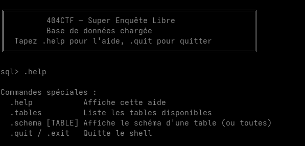
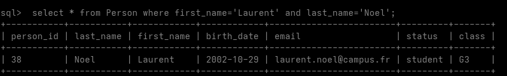
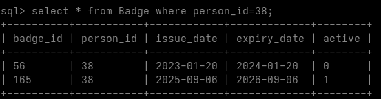

# Super enQuête Libre [1/4]

We portray the role of a detective to solve a case of theft inside of a prestigious school (Télématique NordRouan).
We're given access to a database with the names of all students and teachers aside.

## Objective
For this particular challenge, we have to find the badge number of someone named `Noel Laurent`.

Flag format expected: `404CTF{badge_number}`

## Resolution
We start by logging to solve the challenge:
```bash
nc spawn.404ctf.fr 10401
```
Once we're connected, we display all special commands available using `.help`.
<p align="center">
	
</p>

We then display all tables available and their contents.
<p align="center">
    
</p>

```sql
CREATE TABLE AccessLog (
        log_id INTEGER PRIMARY KEY AUTOINCREMENT,
        badge_id INTEGER NOT NULL REFERENCES Badge(badge_id),
        room_id INTEGER NOT NULL REFERENCES Room(room_id),
        date TEXT NOT NULL,
        time TEXT NOT NULL
    );

CREATE TABLE Attendance (
        attendance_id INTEGER PRIMARY KEY AUTOINCREMENT,
        course_id INTEGER NOT NULL REFERENCES Course(course_id),
        person_id INTEGER NOT NULL REFERENCES Person(person_id),
        badge_id INTEGER REFERENCES Badge(badge_id),
        arrival_time TEXT NOT NULL,
        check_in_mode TEXT NOT NULL CHECK(check_in_mode IN ('card', 'manual'))
    );

CREATE TABLE Badge (
        badge_id INTEGER PRIMARY KEY AUTOINCREMENT,
        person_id INTEGER NOT NULL REFERENCES Person(person_id),
        issue_date TEXT NOT NULL,
        expiry_date TEXT NOT NULL,
        active INTEGER NOT NULL CHECK(active IN (0, 1))
    );

CREATE TABLE Building (
        building_id INTEGER PRIMARY KEY AUTOINCREMENT,
        building_name TEXT NOT NULL UNIQUE,
        nb_floors INTEGER NOT NULL
    );

CREATE TABLE Course (
        course_id INTEGER PRIMARY KEY AUTOINCREMENT,
        room_id INTEGER NOT NULL REFERENCES Room(room_id),
        teacher_id INTEGER NOT NULL REFERENCES Person(person_id),
        subject TEXT NOT NULL,
        date TEXT NOT NULL,
        start_time TEXT NOT NULL,
        end_time TEXT NOT NULL,
        "group" TEXT NOT NULL
    );

CREATE TABLE Person (
        person_id INTEGER PRIMARY KEY AUTOINCREMENT,
        last_name TEXT NOT NULL,
        first_name TEXT NOT NULL,
        birth_date TEXT NOT NULL,
        email TEXT NOT NULL UNIQUE,
        status TEXT NOT NULL CHECK(status IN ('student', 'teacher', 'staff')),
        class TEXT
    );

CREATE TABLE Room (
        room_id INTEGER PRIMARY KEY AUTOINCREMENT,
        building_id INTEGER NOT NULL REFERENCES Building(building_id),
        room_name TEXT NOT NULL UNIQUE,
        floor INTEGER NOT NULL,
        capacity INTEGER NOT NULL,
        projector INTEGER NOT NULL CHECK(projector IN (0, 1))
    );
```

We start by searching a `Noel Laurent` using the fields `first_name` and `last_name` in the `Person` table.
```sql
select * from Person where first_name='Noel' and last_name='Laurent';
```
There is no hit for a `Noel Laurent` so we now search for a `Laurent Noel`
```sql
select * from Person where first_name='Laurent' and last_name='Noel';
```
<p align="center">
	
</p>

Once we have all personal infos of `Laurent Noel`, we check if we have corresponding fields in other tables.
The `Badge` table also uses the `person_id` field and can give us the `badge_id` of anybody.

We can get the badge number of `Laurent Noel` using the `person_id` value previously obtained.
```sql
select * from Badge where person_id=38;
```
<p align="center">
	
</p>
We get two hits with this request. Only one of the badges is active, so we discard the other result.
We can now finish the challenge with the active badge number.

The flag for this challenge is: `404CTF{165}`
