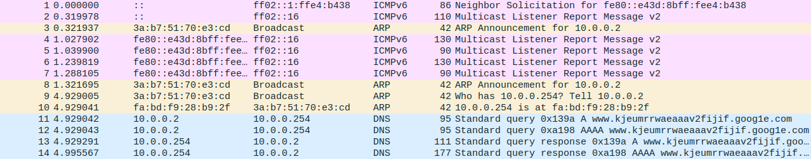
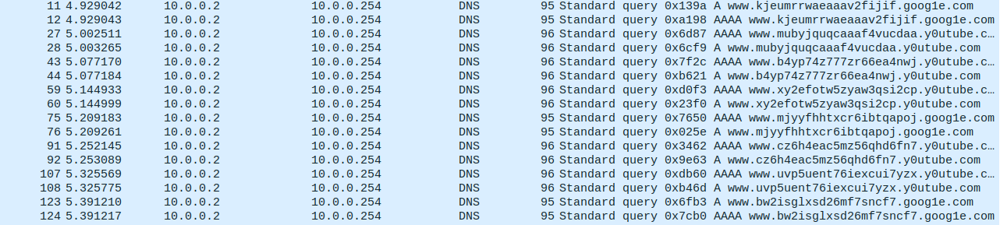
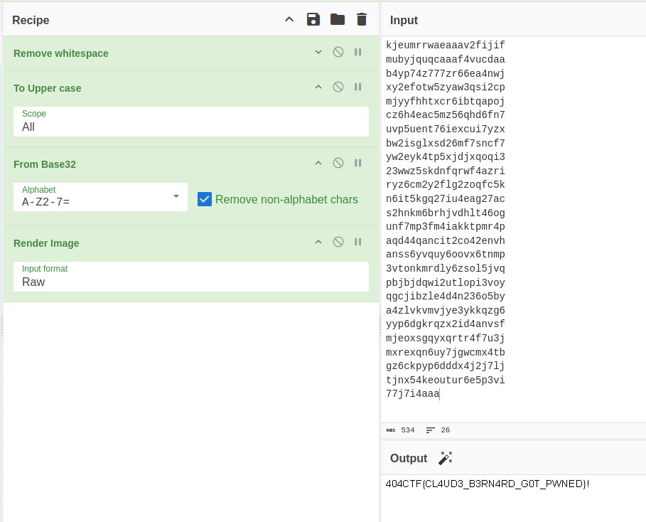

# Extraction d'ADNs

## Objective
Confidential results of an experiment have leaked, our role is to find how.

## Resolution
The first thing we see at the begining of the file is unusual looking domains.
(`goog1e.com`, `y0utube.com` for example)
<p align="center">
	
</p>

We isolate the DNS outgoing queries by typing `dns.flags.response == 0` in the
filter bar in Wireshark.
<p align="center">
	
</p>

We notice that the subdomains are also unusual. This is a classic 
`DNS exfiltration` case where the data is encoded in the subdomains and sent as
queries, blending into normal DNS traffic.


Since the interesting info is in the hostnames, we save those in a file using
tshark
```bash
tshark -r challenge.pcap -Y "dns.flags.response == 0" -T fields -e dns.qry.name > temp.txt
```

Few steps are necessary before going further. We remove doubles tnen remove the scheme and domains from the url. Since the file is rather small, I removed these
parts manually.
```
awk '!seen[$0]++' temp.txt > hostnames.txt
```

Our `hostnames.txt` file looks like this:
```txt
kjeumrrwaeaaav2fijif
mubyjquqcaaaf4vucdaa
b4yp74z777zr66ea4nwj
xy2efotw5zyaw3qsi2cp
mjyyfhhtxcr6ibtqapoj
cz6h4eac5mz56qhd6fn7
uvp5uent76iexcui7yzx
bw2isglxsd26mf7sncf7
yw2eyk4tp5xjdjxqoqi3
23wwz5skdnfqrwf4azri
ryz6cm2y2flg2zoqfc5k
n6it5kgq27iu4eag27ac
s2hnkm6brhjvdhlt46og
unf7mp3fm4iakktpmr4p
aqd44qancit2co42envh
anss6yvquy6oovx6tnmp
3vtonkmrdly6zsol5jvq
pbjbjdqwi2utlopi3voy
qgcjibzle4d4n236o5by
a4zlvkvmvjye3ykkqzg6
yyp6dgkrqzx2id4anvsf
mjeoxsgqyxqrtr4f7u3j
mxrexqn6uy7jgwcmx4tb
gz6ckpyp6dddx4j2j7lj
tjnx54keoutur6e5p3vi
77j7i4aaa
```
We can now go on [CyberChef](https://gchq.github.io/CyberChef/) to decode the data.


We start by removing the newlines. Based on the characters we see (`a-z`, `0-7`)
we convert the data from base32. Since Base32 uses uppercase letters, we convert
the data to uppercase before converting it from the correct base.


The first thing we see in the output is `WEBP` which tells us the expected
output is an image. We apply the last filter and we get the correct output.

<p align="center">
	
</p>

The flag for this challenge is: `404CTF{CL4UD3_B3RN4RD_G0T_PWNED}!`
