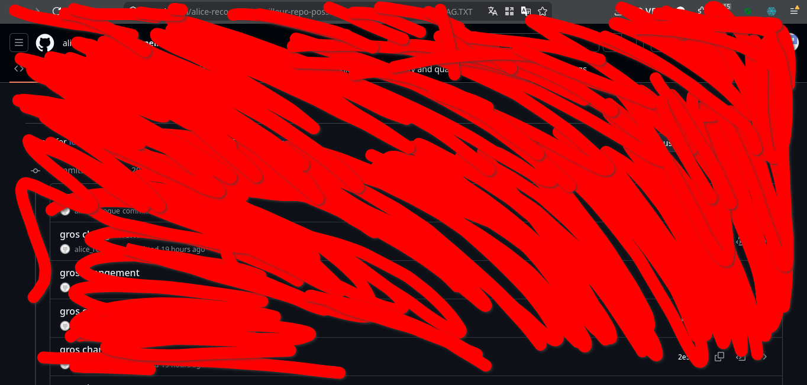

# C'était caché

## Objective
We have to find the flag left on a very famous platform.

Expected flag format: `404CTF{leflag}`

## Resolution
We start by analyzing the image given to us.
<p align="center">

</p>

We can see that the flag is on `Github`, the owner's username starts with `alice-reco`
and the repository contains `r-repo-poss` in its' name.
Searching `alice-reco` on github allows us the find the owner of the repository
and the [repository](https://github.com/alice-recoque/le-meilleur-repo-possible)
itself.

Once cloned on our computer we can start by searching all the files
containing `flag` in it's name.
```bash
find . -type f -name "flag*" 2>/dev/null
./a/o/e/flag.txt
./f/r/s/flag.txt
./f/t/l/flag.txt
./l/o/l/flag.txt
./s/o/s/flag.txt
./s/t/k/flag.txt
./v/i/m/flag.txt
./w/o/w/flag.txt
```

We `cat` each of these files to see which one contains the good flag.
```bash
cat ./s/t/k/flag.txt
Bravo ! 
404CTF{CENSURÉ}
Après réflexion, ça me paraissait abusé d'avoir le flag sur un repo public comme ça...
Heureusement j'ai très vite censuré ça !
```

We know the path of the flag is `./s/t/k/flag.txt`, all we need to do is go back to
the good version.
```bash
git checkout d12c5e08b84cfd0623fc70b3653af4a61f0525f4
cat ./s/t/k/flag.txt
Bravo ! 
404CTF{PLuT0T_FriTE5_0û_P0T@T03S?}
```

The flag for this challenge is `404CTF{PLuT0T_FriTE5_0û_P0T@T03S?}`.
