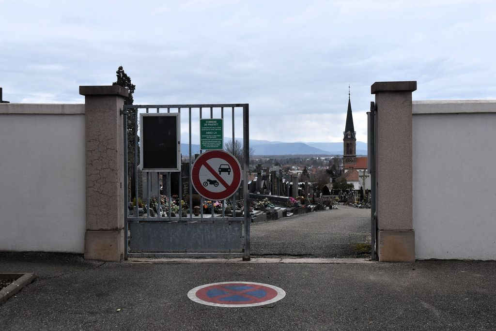

# Chaud Devant

## Objective
We have to find a few informations about a scientist to capture the flag.
The information we have to find are:
- Year of death
- The mount where she died
- Her lastname
- Day of birth
- Husband's month of birth

Flag format expected: `404CTF{2026_Everest_Curie_01_01}`

## Resolution

We start by analyzing the image given.

	

We can see on this image that the graveyard is located in Pfastatt.
A simple internet search tells us the scientists buried in Pfastatt are
[Katia and Maurice Krafft](https://en.wikipedia.org/wiki/Katia_and_Maurice_Krafft).

Once on their Wikipedia page, we can collect all informations needed to capture the
flag.
- Year of death: 1991
- The mount where she died: Unzen
- Her lastname: Krafft
- Day of birth: 17
- Husband's month of birth: 03

The flag for this challenge is `404CTF{1991_Unzen_Krafft_17_03}`
