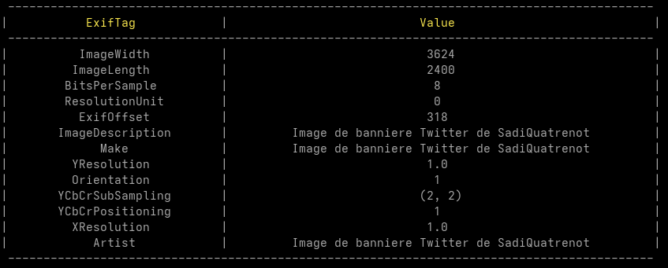
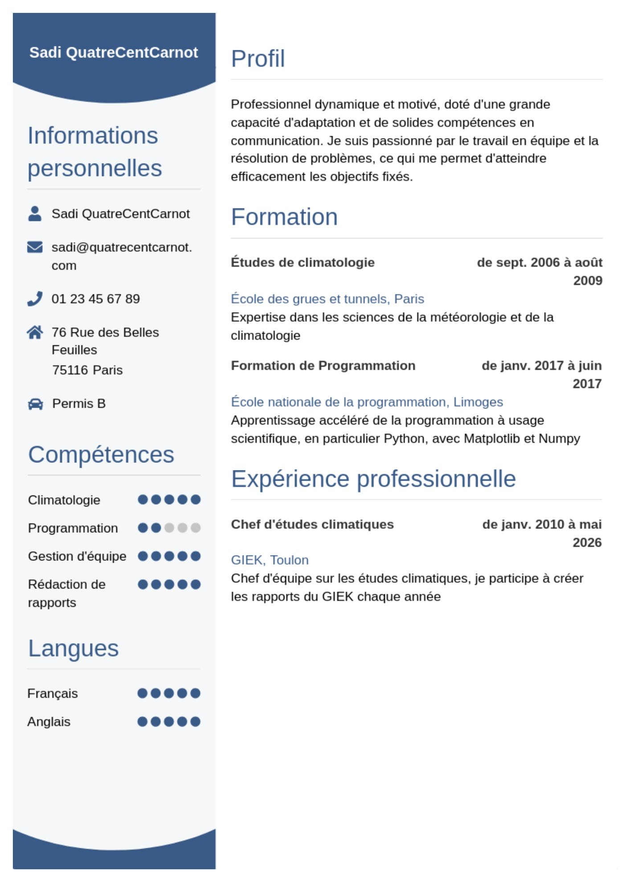

# Doctor Es Lingues

## Objective
We have to find the language spoken by a reseacher that uses the image given to us
as a banner.

Flag format expected: `404CTF{klingon}`

## Resolution
We start by looking at the image given to us for this challenge.

<p align="center">
	
</p>

When searching this image on Google Images, we find too many results and nothing
conclusive. We then decide to check for EXIF data. There are many ways to get the
EXIF data for images but I decided to use my program developped for school.
```python
from PIL import Image, ExifTags
from termcolor import colored


def message(type, message):
    match type:
        case 0:
            str = colored('\rError: ', 'red') + message
        case 1:
            str = colored('\rWarning: ', 'light_yellow') + message
        case 2:
            str = colored('\rSaving: ', 'light_green') + message
    return str


def truncate(str, length):
    if len(str) > length:
        return str[:length] + '...'
    return str


def display_exif(exif_data):
    print('', "-" * 91)
    exiftag_h = colored(f"{'ExifTag':^30}", 'light_yellow')
    value_h = colored(f"{'Value':^60}", 'light_yellow')
    print(f"|{exiftag_h}|{value_h}|")
    print('', "-" * 91)
    for key, val in exif_data.items():
        if key in ExifTags.TAGS:
            print(f"|{ExifTags.TAGS[key]:^30}|{truncate(str(val), 50):^60}|")
        else:
            print(f"|{key:^30}|{truncate(str(val), 50):^60}|")
    print('', "-" * 91)
    print()


def display_data(image):
    try:
        im = Image.open(image)
    except OSError:
        raise SystemExit(message(0, "can't open file"))
    exif_data = im.getexif()
    if not exif_data:
        print(message(1, "there is no exif data"))
        return
    display_exif(exif_data)


def main():
    display_data("banniere.jpg")


if __name__ == "__main__":
    main()
```

This allows us to see the banner is used by a certain `SadiQuatrenot` on `Twitter`.
<p align="center">
	
</p>

Once we're on the Twitter of [SadiQuatrenot](https://x.com/SadiQuatrenot), we can see
in the media section a resume and the banner image.


The tweet accompanying the resume gives us a link for his 
[personal blog](https://quiestsadiquatrenot.blogspot.com/2026/05/presentation.html)
where he presents himself a little.
The important part resides in the last sentence of his presentation where he says he
fixed typos that were on his previous resume.


The resumes on the blog and Twitter are the same so we need to find if there's any
previous versions anywhere else.
Pasting the presentation link on the [Wayback Machine](https://web.archive.org/)
shows us his blog has been archived several times before.
I decided to look at the first [archive](https://web.archive.org/web/20260507223523/https://quiestsadiquatrenot.blogspot.com/2026/05/presentation.html)
made on May 7th and we can see that there's a new line on his resume.
The line says `Appretissage du malais       de sept. 2009 à janv. 2020`.

Before Modification        |  After Modification
:-------------------------:|:-------------------------:
  |  

We can conclude that the flag for this challenge is `404CTF{malais}`.
