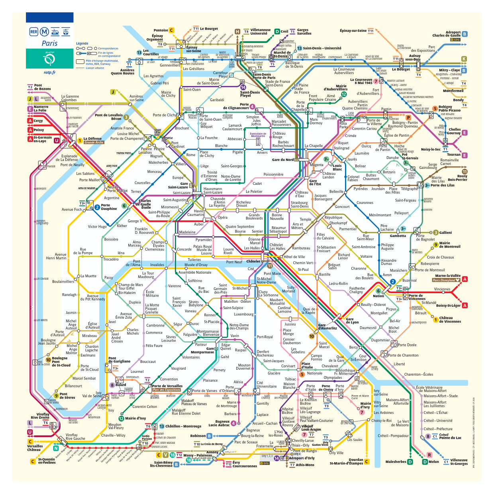
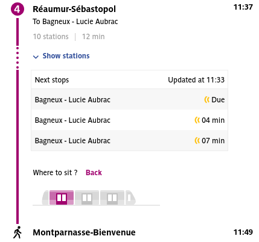

# Métro OSINT Dodo

## Objective
A few months ago, late in the morning, it took me over half an hour to make a direct trip that normally takes 11 to 12 minutes. All because of a passenger who fell ill at Châtelet. My route was between two stations named after scientists.

Which two stations were they?

Expected flag format: `404CTF{les-halles_republique}`

## Resolution

We take a map of the metro in Paris.

    

We take all the metro lines passing trough Châtelet, so we're left with the lines 4, 8,
and 14.

We now look for metro stations named after scientists who are also around Châtelet.
We're left with the stations `Réaumur-Sébastopol` and `Montparnasse-Bienvenüe`
respectively named after
[René Antoine Ferchault de Réaumur](https://en.wikipedia.org/wiki/Ren%C3%A9_Antoine_Ferchault_de_R%C3%A9aumur)
and [Fulgence Bienvenüe](https://en.wikipedia.org/wiki/Fulgence_Bienven%C3%BCe).

We can confirm these are the correct stations by searching how long it would take to
make the trip.

    

The flag for this challenge is: `404CTF{reaumur-sebastopol_montparnasse-bienvenue}`
