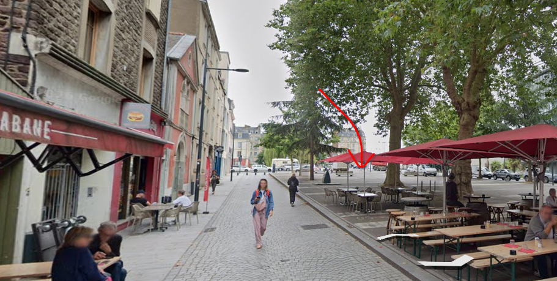
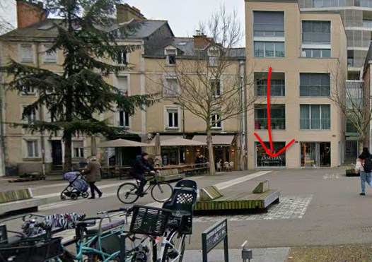

# Un stand pas très standard

## Objective
A researcher friend contacts you: "When I went to a conference six or seven years ago,
I stumbled upon a great market stall, but I can't for the life of me remember what they
were selling there! I'm sending you a few photos with arrows to show you its approximate
location... If it helps, it was the stall located farthest to the northeast of all."

Will you be able to figure out the type of business your friend is thinking of?

Expected flag format: `404CTF{apiculture}`

## Resolution

We look at the images given to us for this challenge

    
    

On the first image, we can guess that the full name for the commerce on the left is
`Cabane`. A simple image search with this keyword allows us to find the location of this
place. It is [La Cabane](https://maps.app.goo.gl/QQ4GgrbCqKtsg7G88) located in `Rennes`.

When searching markets in Rennes at this address, we find there's one, the
`Marché Bio du Mail`.

There's also a [Facebook page](https://www.facebook.com/marchedufmmail) for this market.

Based on the instructions given, we have to look for an edition that happened between
`2019-2020`. We find there was an edition that happened in
[2019](https://www.facebook.com/photo.php?fbid=1249031058602414&set=pb.100064824035738.-2207520000&type=3) with the list of market vendors and their fields.

We use the second photo to pinpoint where the market stall was located.
On this [picture](https://www.facebook.com/photo/?fbid=1627096914129158&set=pb.100064824035738.-2207520000) we can recognize the building in the back being built
and recognize the white line on the ground. We can also look around on Google Maps and
confirm this is the correct market stall.

Based on two Facebook photos linked here, we recognize the market stall belongs to
`La Coqcinelle` and they're on this market to sell fruits and vegetables.

The field of producing and selling your own fruits and vegetables is called `maraichage`,
therefore the flag for this challenge is `404{maraichage}`.
